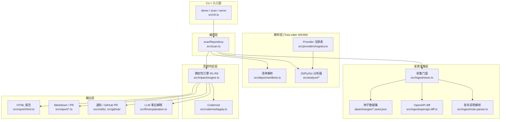
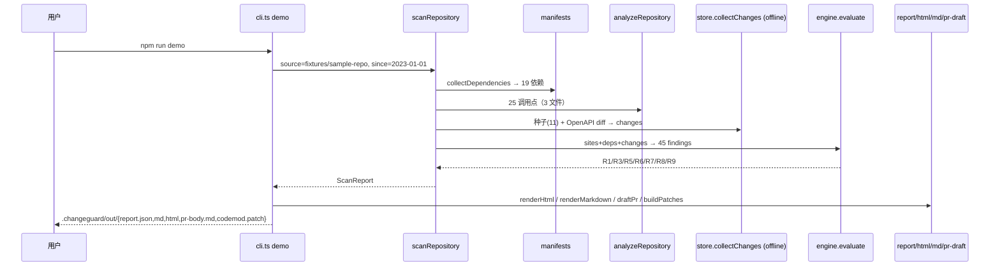
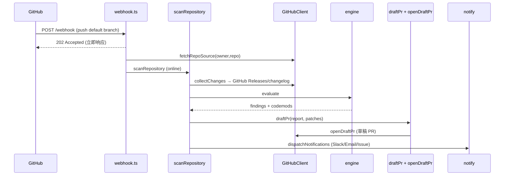

# ChangeGuard 变更哨兵 — 架构设计文档

> 版本 1.0 · 面向开发/测试 · 所有模块均绑定真实源码路径与函数锚点
> 项目根：仓库根目录（本文中的路径均为仓库相对路径，如 `src/scan.ts`）

---

## 1. 产品定位与设计原则

**一句话**：监控第三方 API/SDK 的破坏性变更，自动定位代码影响点，产出升级清单与可合入的 PR 草稿。

**硬性范围（首版）**：
- 支持厂商：Stripe、OpenAI、Shopify、Twilio、Supabase
- 支持语言：JavaScript/TypeScript、Python、Go
- 支持清单：`package.json` / `requirements*.txt` / `go.mod`

**设计原则（贯穿全系统）**：
1. **判定确定性，LLM 只做解释** — 所有 finding（影响判定、严重级、置信度）均由 AST 调用点 × 变更记录 × 版本规则的确定性规则产出；LLM 仅在事后把已决定的事实改写成中文说明，任何异常都回退到模板。参见 `explanation.ts L1-L9`。
2. **流水线单向、可重放** — `manifests → 调用点 → 变更 → 引擎 → 报告`，每步输入输出均为纯结构化类型，离线种子数据可完整重放。
3. **无密钥可运行** — demo 完全离线，无任何外部依赖；在线能力与通知通道均可选配置。

---

## 2. 总体架构

### 2.1 分层图

### 2.2 核心数据类型（贯穿全流程）

定义于 `types.ts`：

| 类型 | 行 | 含义 |
|---|---|---|
| `Dependency` | `L22` | 清单依赖（生态/包名/版本/providerId） |
| `CallSite` | `L43` | AST 提取的第三方调用点（path/keys/literals/memberRefs/http） |
| `ChangeRecord` | `L105` | 厂商变更（operations/renames/versions/migration） |
| `Finding` | `L151` | 影响发现（ruleId/severity/confidence/codemod） |
| `ScanReport` | `L179` | 一次扫描的完整产物 |

---

## 3. 核心模块说明

### 3.1 入口与编排

**CLI** — `cli.ts`
- 三条命令：`demo`（离线扫内置示例）、`scan <path>`（本地仓库）、`serve`（GitHub App webhook）。
- demo 输出 `report.json/md/html`、`pr-body.md`、`codemod.patch` 到 `.changeguard/out/`。

**扫描编排** — `scan.ts`
- `scanRepository` `L47`：四阶段流水线。
  1. `collectDependencies` 解析清单并 `annotateProviders`（回填 providerId，`L40`）。
  2. `analyzeRepository` Tree-sitter 提取调用点。
  3. `collectChanges` 采集厂商变更（离线=种子+OpenAPI diff，在线=GitHub Releases+changelog，6h 文件缓存）。
  4. `evaluate` 确定性规则引擎，再 `collapseCorroboratingHttp`（同一 R6 命中跨源合并，`L123`）。
- 输出 `ScanReport`，findings 按 severity→file→line 排序。

### 3.2 Provider 注册表

`registry.ts`

厂商是**纯数据**：每家一家 manifest 文件 `data/providers/<id>.json`（文件名=id），启动时由
`loadProviderManifests()` 加载并逐个经 `validateProviderManifest()` 严格校验——字段错误
（缺 id、未知生态/语言、坏 githubReleases、JSON 语法错误、文件名与 id 不符）一律
fail-fast，错误信息带文件名与字段。新增厂商 = 加一个 JSON 文件，零代码改动。

- `PROVIDERS`：5 家内置厂商的完整配置（包名、REST hosts、工厂常量、变更数据源），由 manifest 加载而来。
- `providerForPackage(ecosystem, name, providers?)`：包名→厂商（大小写不敏感双端比较；支持 npm 子路径前缀、Go 完整模块路径含 `/vN`、PyPI 归一化）。`providers` 参数可注入，测试用。
- `providerForHost(hostname, providers?)`：裸 HTTP 主机后缀→厂商。
- `buildAnalyzerIndex(providers?)`：把每家厂商编译成三语言分析规则；`providers` 可注入。
- `validateProviderManifest` / `loadProviderManifests`：结构校验与目录加载（可传目录，测试与自定义部署用）。

### 3.3 清单解析

`manifests.ts`
- `parsePackageJson` `L30`：runtime/dev/optional/peer 四桶，剥离 link/workspace 规格。
- `parseRequirementsTxt` `L57`：支持 extras、`#egg=` 形式 VCS 依赖、内联注释；`normalizePyName` 归一化（`[-_.]+`→`-`）。
- `parseGoMod` `L88`：单行 + 块 require，标注 `// indirect`，保留 `/vN` 主版本。

### 3.4 Tree-sitter 调用点分析

**抽象** — `parser.ts`
- `AstParser` `L74`：web-tree-sitter WASM 封装，按需加载 typescript/python/go 语法。
- `EXTENSION_LANGUAGE` `L54`：扩展名→语言映射。

**编排** — `analyze/index.ts`
- `analyzeRepository` `L25`：逐文件解析，单文件失败不中止整轮；调用点按 file/line/path 排序。

**三语言分析器**（均处理绑定传播、多级成员链、参数键值、枚举字面量）：
- JavaScript/TS：`js-analyzer.ts L92`
- Python：`py-analyzer.ts L63`
- Go：`go-analyzer.ts L73`（处理 `qualified_type`、复合字面量、`/vN` 模块归一化）。

**共享工具** — `ts-utils.ts`
- `chainSegments` `L47`：下降多级成员链；`sameNode` `L33`：用 `node.equals()` 规避 web-tree-sitter 无引用同一性问题。

### 3.5 变更采集

**采集门面** — `store.ts`
- `loadBundledChanges` `L34`：读 `data/changes/*.seed.json`。
- `loadBundledOpenApiDiffs` `L48`：读 `data/openapi/{provider}/{old,new,meta}.json` 并 diff。
- `collectChanges` `L102`：离线直接返回种子；在线追加 GitHub Releases 与 changelog，按 key 写文件缓存（6h TTL，`L24`）。
- `dedupeAndSort` `L145`：`provider:date:title` 去重留高置信度，按日期降序。

**OpenAPI diff** — `openapi-diff.ts`
- `diffOpenApi` `L157`：输出 9 类结构化变更（见 §5.2）。
- `extractRename` `L372`：从 diff 文本提取重命名。

**发布说明解析** — `note-parser.ts`
- `classify` `L64`：词法信号判定 breaking/deprecation/behavior/feature。
- `parseNoteEntry` `L157`：从一段 markdown 抽取 operation/parameter/enum/sdk-path/version。
- `splitReleaseNotes` `L217`：按 `##` 标题拆发布说明为候选条目。

**在线抓取**：`github-releases.ts L30` `fetchReleaseChanges`；`changelog-html.ts L37` `fetchChangelogChanges`。

### 3.6 确定性影响引擎

`engine.ts`
- `evaluate` `L139`：遍历变更×调用点×依赖，产出 `Finding[]`。
- 8 条规则（R1/R2/R3/R5/R6/R7/R8/R9），每条有固定 `ruleId`、`match`、`severity`、`confidence` 与 codemod 产出条件。详见 §5.1。
- 去重 key 含 `reason`，使同一调用点的多参数影响不被吞（`L148`）。
- SDK 路径匹配仅在 `operation / sdk-method / api-version` 三种 scope 下触发，避免 parameter/enum 误触发 R1（`L66`）。

### 3.7 Codemod

`apply.ts`
- `applyCodemods` `L125`：对引擎产出的 `rename-method`/`rename-parameter` 做保守文本替换（调用表达式行区间内，括号配平限定 15 行）。
- `unifiedDiff` `L71`：3 行上下文统一 diff。
- `buildPatches` `L177`：按文件聚合补丁，无实际改动则跳过。

### 3.8 报告与 PR 草稿

- HTML 报告：`html.ts` `renderHtml` — 单文件自包含（内联 CSS/JS，零外链），按 provider 分组，支持高风险/可修复筛选。
- Markdown：`markdown.ts L10` `renderMarkdown`，`renderUpgradeChecklist` `L79`。
- PR 草稿：`pr-draft.ts L17` `draftPr` — 标题/摘要表/升级清单/codemod diff/厂商参考，正文由确定性模板拼装。

### 3.9 LLM 解释（事后，非判定）

`explanation.ts`
- `templateExplain` `L41`：纯模板，无网络。
- `explainChange` `L105`：有 `LLM_API_KEY` 才调 OpenAI 兼容 `/chat/completions`（temperature 0、json_object、系统提示约束"只能复述事实"），任何失败回退模板。
- `enrichReport` `L131`：按 changeId 缓存解释挂到 findings。

### 3.10 GitHub 集成

`auth.ts`
- `createAppJwt` `L14`：`node:crypto` 手写 RS256，零第三方 JWT 库。
- `getInstallationToken` `L37`：安装令牌，缓存至过期前 5 分钟。
- `resolveToken` `L62`：优先 `GITHUB_TOKEN`，否则走 App 安装流。

`api.ts`
- `fetchRepoSource` `L47`：递归读默认分支树→`VirtualRepoSource`，过滤 node_modules 等。
- `openDraftPr` `L78`：建分支→上传 blob→建树/提交→开**草稿** PR（仅应用确定性 codemod）。
- `createIssue` `L142`。

### 3.11 Webhook 服务

`webhook.ts`
- `startServer` `L107`：`node:http`，`/healthz` 健康检查、`POST /webhook` 接收事件。
- HMAC SHA256 签名校验（无 secret 时本地开发放行）。
- 事件：`ping`、`installation`、`installation_repositories`、`push`（仅默认分支）。扫描异步入队，HTTP 立即返回 202（避免 GitHub 超时重投）。

### 3.12 通知

`index.ts`
- `notifySlack` `L15`：incoming webhook POST。
- `sendEmail` `L37`：零依赖 SMTPS（隐式 TLS:465 + AUTH LOGIN）。
- `notifyGitHubIssue` `L133`：复用 `GitHubClient`，带 marker 防重复建单。
- `dispatchNotifications` `L156`：逐通道 try/catch，通道失败不影响扫描。

---

## 4. 运行流程

### 4.1 离线 demo 时序

### 4.2 在线 webhook → PR 时序

---

## 5. 确定性规则详解

### 5.1 影响引擎规则 R1–R9

| 规则 | 触发条件 | 严重级 | 置信度 | Codemod |
|---|---|---|---|---|
| **R1** exact SDK 路径 | 调用点 path 等于 operation/sdk-method 的 sdkPath | breaking=high, deprecation=medium | 高 | 否 |
| **R2** 命名空间前缀 | 调用点落在 `resource.*` 已变更命名空间下 | breaking=high | 中 | 否 |
| **R3** 受影响参数/字段 | parameter/request-field 的 target 出现在 `argumentKeys` | breaking=high | 高 | 否 |
| **R5** 移除枚举值 | enum detail `removed:x` 的值出现在 argumentLiterals/memberRefs | high | 高 | 否 |
| **R6** 裸 HTTP | http.method+url 匹配 operation 的 pathTemplate | breaking=high | 高 | 否 |
| **R7** 依赖版本钉死 | 已装版本 < `removedIn`(high) 或 < `deprecatedIn`(medium) | high/medium | 高/中 | 否 |
| **R8** 官方重命名 | rename.method/parameter 匹配调用点或参数键 | breaking=high, deprecation=medium | 高 | **是** |
| **R9** 仓库级建议 | provider 在用但无具体调用命中（breaking=medium/deprecation=low） | medium/low | 低 | 否 |

注：R1/R2 仅在 `operation / sdk-method / api-version` scope 触发；R3/R5/R8 对 parameter/enum/rename 单独判定。

### 5.2 OpenAPI diff 变更类型 D1–D9

| 类别 | 含义 | scope |
|---|---|---|
| D1 | operation 移除 | operation |
| D2 | 整条 path 移除 | service |
| D3 | required 请求参数增加 | parameter |
| D4 | 请求参数移除/重命名 | parameter |
| D5 | request body 字段移除/新增 required | request-field |
| D6 | response 字段移除 | response-field |
| D7 | 枚举值移除(请求)/新增(响应) | enum |
| D8 | operation 标 deprecated | operation |
| D9 | 类型声明变更 | field |

---

## 6. 数据与缓存策略

**无数据库。** 全部数据落盘为 JSON：

| 位置 | 内容 | 生命周期 |
|---|---|---|
| `data/changes/*.seed.json` | 5 家厂商精选变更记录 | 随仓库版本发布 |
| `data/openapi/{provider}/{old,new,meta}.json` | OpenAPI 快照对 | 随仓库版本发布 |
| `.changeguard/cache/*.json` | 在线抓取结果（`{fetchedAt,records}`） | 6 小时 TTL（`store.ts L24`） |
| `.changeguard/out/*` | 扫描产物（JSON/MD/HTML/PR/patch） | 每次覆盖 |

---

## 7. 配置与环境变量

`config.ts` 加载 `.env`（无则忽略）。全部可选：

| 变量 | 作用 |
|---|---|
| `LLM_API_KEY` | 启用 LLM 解释；未设则全程模板 |
| `LLM_BASE_URL` / `LLM_MODEL` | OpenAI 兼容端点与模型 |
| `GITHUB_APP_ID` / `GITHUB_PRIVATE_KEY` | GitHub App 认证（PEM 内容或路径） |
| `GITHUB_WEBHOOK_SECRET` | webhook HMAC 校验 |
| `GITHUB_TOKEN` | 替代 App 的 PAT |
| `SLACK_WEBHOOK_URL` | Slack 通知 |
| `SMTP_URL` / `EMAIL_TO` | 邮件通知 |
| `PORT` | webhook 端口（默认 8787） |
| `CHANGEGUARD_CACHE_DIR` | 缓存目录（默认 `.changeguard/cache`） |

---

## 8. 功能 — 源码追溯矩阵（RTM）

> 粒度口径：以"可独立验证的功能点"为一项；去重后 28 项。每项给出主源码锚点，覆盖对应测试文件。

| # | 功能点 | 主源码锚点 | 测试 |
|---|---|---|---|
| 1 | npm 清单解析（含 dev 区分、link 规格过滤） | `manifests.ts L30` | `manifests.test.ts` |
| 2 | requirements.txt 解析（extras、#egg、注释） | `manifests.ts L57` | 同上 |
| 3 | go.mod 解析（块 require、indirect、/vN） | `manifests.ts L88` | 同上 |
| 4 | 包名→厂商映射 | `registry.ts L162` | — |
| 5 | 主机名→厂商映射 | `registry.ts L172` | — |
| 6 | JS/TS 调用点提取（含多级链、参数键） | `js-analyzer.ts L92` | `analyzers.test.ts` |
| 7 | Python 调用点提取（kwargs、工厂抑制） | `py-analyzer.ts L63` | 同上 |
| 8 | Go 调用点提取（struct 传播、qualified_type） | `go-analyzer.ts L73` | 同上 |
| 9 | 裸 HTTP 调用识别 | [js/py/go]-analyzer | `scan-e2e.test.ts` |
| 10 | 种子变更加载 | `store.ts L34` | scan-e2e |
| 11 | OpenAPI old/new diff（D1-D9） | `openapi-diff.ts L157` | `openapi-diff.test.ts` |
| 12 | 发布说明分类（breaking/deprecation/...） | `note-parser.ts L64` | `note-parser.test.ts` |
| 13 | 发布说明条目结构化解析 | `note-parser.ts L157` | 同上 |
| 14 | R1 精确 SDK 路径匹配 | `engine.ts L176` | `engine.test.ts` |
| 15 | R2 命名空间前缀匹配 | `engine.ts L195` | 同上 |
| 16 | R3 受影响参数/字段 | `engine.ts L210` | 同上 |
| 17 | R5 枚举值命中 | `engine.ts L246` | 同上 |
| 18 | R6 裸 HTTP 路径匹配 | `engine.ts L286` | 同上 |
| 19 | R7 依赖版本钉死 | `engine.ts L361` | 同上 |
| 20 | R8 重命名 + codemod | `engine.ts L307` | 同上 |
| 21 | R9 仓库级建议 | `engine.ts L394` | 同上 |
| 22 | codemod 文本替换（含多行调用） | `apply.ts L125` | `codemod.test.ts` |
| 23 | unified diff 生成 | `apply.ts L71` | 同上 |
| 24 | HTML 报告渲染（自包含） | `html.ts` | scan-e2e |
| 25 | Markdown 报告 + 升级清单 | `markdown.ts L10` | scan-e2e |
| 26 | PR 草稿正文拼装 | `pr-draft.ts L17` | scan-e2e |
| 27 | LLM 解释 + 模板兜底 | `explanation.ts L105` | — |
| 28 | 端到端离线扫描 | `scan.ts L47` | scan-e2e |

---

## 9. 测试体系

`tests/` 共 7 个文件，40 个用例（`npm test` 全绿）：

| 文件 | 覆盖 |
|---|---|
| `manifests.test.ts` | 三语言清单解析边界 |
| `openapi-diff.test.ts` | D1/D7/D8 等 diff 规则 |
| `note-parser.test.ts` | 分类、结构化解析、拆分 |
| `engine.test.ts` | R1-R9 各规则与 codemod 产出 |
| `codemod.test.ts` | 4 种重命名 + unified diff |
| `analyzers.test.ts` | 三分析器对 fixture 的关键路径断言 |
| `scan-e2e.test.ts` | 离线全流程 + 报告产物自包含性 |

---

## 10. 文档维护规范

1. **真实性优先**：任何写入本文档的文件路径、函数名、行号，必须来自实际 `grep`/读取结果，不得凭记忆编写。新增模块时同步更新 RTM 与分层图。
2. **锚点更新**：重构导致行号漂移时，重新 `grep` 关键符号（`export function/class`、`ruleId:`）并更新对应表格行号。
3. **规则变更同步**：引擎增删规则（R 系列）或 OpenAPI diff 类别（D 系列）时，必须同步更新 §5 表格与对应测试。
4. **范围红线**：首版固定 5 厂商 × 3 语言，不在本文档承诺额外厂商/语言，除非已在 `registry.ts`、`data/`、测试中落地。
5. **LLM 边界不可越**：任何把"影响判定/严重级"交给 LLM 的改动都违反核心原则，需在 PR 中显式说明并由评审否决。

---

*文档生成方式：基于源码 grep 锚点 + 实际运行验证（demo=45 findings，test=40/40 通过），未使用未核实信息。*
